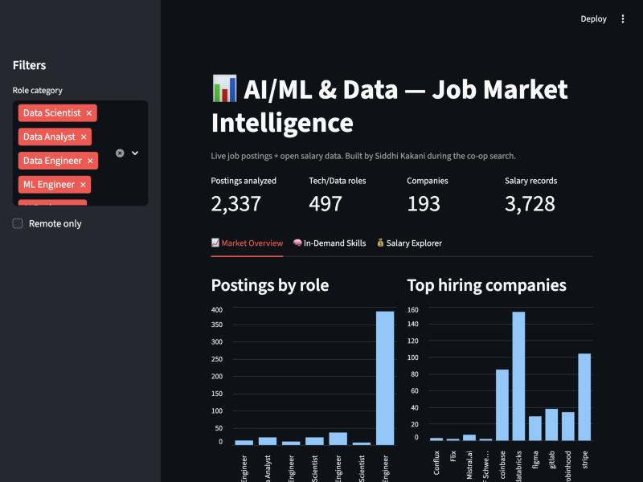

# AI/ML Job Market Intelligence

An end-to-end data product that collects real job postings, analyzes **in-demand skills, salaries, and locations** for AI/ML & Data roles, and presents the findings in an interactive dashboard with a salary-prediction model.

> Built during my own co-op search to understand which skills and markets matter most.

## Status — ✅ Complete
- [x] **Phase 1 — Data collection** (2,700+ live postings from Remotive, Arbeitnow, Greenhouse → SQLite)
- [x] **Phase 2 — Cleaning & EDA** (role categorization, dedupe, overview charts)
- [x] **Phase 3 — Skill analysis (NLP)** (55-skill taxonomy, demand ranking, skills-by-role heatmap)
- [x] **Phase 4 — Salary model** (Random Forest, MAE ~$36.7K, R² 0.42, feature importance)
- [x] **Phase 5 — Interactive Streamlit dashboard** (market overview, skills explorer, salary predictor)



## Key findings
- Top in-demand skills for AI/ML & Data roles: **Python (37%), AWS, SQL, Generative AI, LLMs, Spark**.
- Salary is driven most by **experience level** and **company location**; senior ML/Data Engineers median **$150K–$170K**.
- Sample skews toward large tech employers (Databricks, Stripe) — a documented limitation.

## Tech stack
Python · requests · SQLite/SQL · pandas · scikit-learn · spaCy/regex (NLP) · Streamlit · matplotlib/seaborn

## Data sources (all free / public)
| Source | Access | Notes |
|---|---|---|
| Remotive | `remotive.com/api/remote-jobs` | Remote tech jobs, no key |
| Arbeitnow | `arbeitnow.com/api/job-board-api` | Open job board, no key |
| Greenhouse boards | `boards-api.greenhouse.io/v1/boards/{company}/jobs` | Real postings from many companies |
| ai-jobs.net salaries *(Phase 4)* | `aijobs.net/salaries/` | Open salary dataset for modeling |

## Project structure
```
job-market-intel/
├── data/jobs.db        # SQLite database (collected postings)
├── src/
│   ├── db.py           # SQLite helpers + schema
│   ├── collect.py      # Phase 1: pull postings from APIs
│   ├── clean.py        # Phase 2 (next)
│   ├── analyze.py      # Phase 3
│   └── model.py        # Phase 4
├── app/dashboard.py    # Phase 5 (Streamlit)
├── requirements.txt
└── README.md
```

## Quickstart
```bash
pip install -r requirements.txt
cd src
python collect.py     # Phase 1: pull live postings into data/jobs.db
python clean.py       # Phase 2: normalize + categorize
python eda.py         # Phase 2: overview charts
python analyze.py     # Phase 3: skill extraction + charts
python model.py       # Phase 4: salary model + charts
cd ..
streamlit run app/dashboard.py   # Phase 5: interactive dashboard
```

## Deploy the dashboard (free, shareable link)
1. Push this repo to GitHub.
2. Go to **share.streamlit.io** → "New app" → pick your repo → main file `app/dashboard.py`.
3. It builds from `requirements.txt` and gives you a public URL to put on your resume.
   *(Tip: commit `data/jobs.db` and `data/salaries.csv` so the deployed app has data, or let `collect.py`/`model.py` fetch on first run.)*
